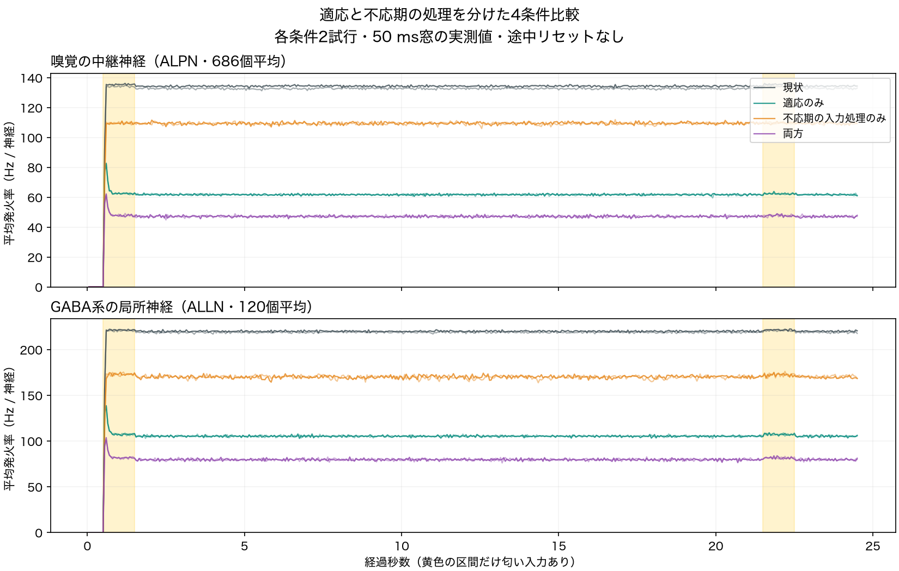
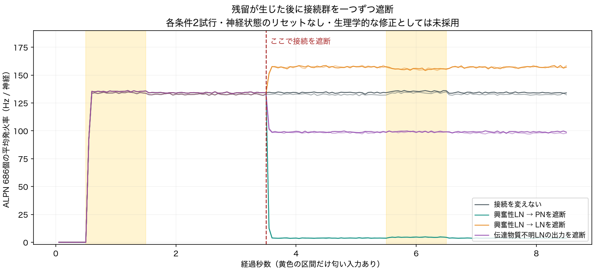

# 嗅覚残留の適応・不応期・LN入力比較（2026-09-17）

## この実験の範囲

稼働中のラボとは別のJavaプロセスで実施。上流ソース・接続データは固定SHAを検証し、変更したのは一時ビルド内の不応期入力の扱いと、受動的な測定カウンターだけ。適応は既存実装の設定で切替。元データ・本体・2D UI・ラボの設定・LLM接続は変更していない。

結果はこのモデル内の因果と挙動の評価であり、生きたハエの探索、食欲、混乱、嗅覚記憶を直接測ったものではない。今回は空腹・満腹、別の匂い、視覚の追加には進めていない。

## 先に確認したこと

### Brian2との小回路比較

本家Shiuのv/g方程式と不応期の書込保護をBrian2 2.10.1で実行。初期発火後、不応期内と終了後に既知の入力を入れた。

| 不応期中の入力100 mV相当 | 到来後のg |
|---|---:|
| 現状Java | 100 mV |
| 入力破棄を加えたJava | 0 mV |
| Brian2 | 0 mV |

終了後の入力は両方で受け取ることも確認した。これは**不応期中に到来した入力を保持するか**の照合。Javaは到来入力を積分の前、Brian2の既定スケジュールは後に適用するため、全波形・発火時刻が完全一致するという意味ではない。閾値の比較演算子とPoisson刺激方法にも差があり、不応期の丸めを含めた全ソルバー同等性は未検証。本家のreset式からはv/gに関わる部分を使った。

[比較結果](results/checks/reference-report.json)・[Java波形](results/checks/reference-java.csv)・[Brian2波形](results/checks/reference-brian2.csv)。参考: [本家コード](https://github.com/philshiu/Drosophila_brain_model/blob/91bdd1e7dcf193f3e7ca5a8933497fcef63b7960/model.py)、[Brian2不応期仕様](https://brian2.readthedocs.io/en/stable/user/refractoriness.html)。

### 測定が回路を変えていないか

- カウンター有効/無効で同じ3.5秒・70窓の神経発火率と総発火数が完全一致。
- 旧60秒試験の最初70窓と、ORN/ALPNの140値が完全一致。
- 一本のGABA接続で、2 msの遅延、重み、入力係数、不応期への到来分類を検証。入力を破棄した場合の実際のgとも一致。
- 4条件の最初から無刺激の対照（各3.5秒）は、全回路発火0、PNへの入力0。

[検証記録](results/checks/counter-validation.json)・[到来カウンター試験](results/checks/audit-fixture.log)・[無刺激対照](results/checks/zero-input-controls.json)。

## 4条件比較

2つのseedを全条件で共用。0.5秒静穏→ORN_DM1+ORN_VA2に60 Hzを1秒→20秒無入力→同じ刺激1秒→2秒無入力。dt=.5 ms、gain=.65、KC入力gain=.25、単一worker、spike log無効。Poissonの乱数列は条件間で同じ（乱数消費は刺激生成だけで、spike logによる乱数消費は無効）。

適応ありは既存の閾値上昇1 mV/発火、回復時定数100 ms。前の単体機能試験と同じ値を実行前に固定し、結果を見ながら調整していない。**生理学的な校正値ではない。** 上流の強制Poisson発火はこの閾値判定を通らないため、受容体の適応を再現したものでもない。

[実行前プロトコル](results/factorial/protocol.json)・[集計](results/factorial/report.json)。

| 条件 | 刺激中末尾 | OFF2秒 | OFF20秒 | 再刺激中 | 再OFF2秒 |
|---|---:|---:|---:|---:|---:|
| 現状 | 134.13–135.52 | 132.70–134.26 | 132.68–134.42 | 134.27–135.50 | 132.74–134.42 |
| 適応のみ | 62.32–62.45 | 61.71–61.74 | 61.67–61.72 | 62.30–62.31 | 61.65–61.69 |
| 不応期入力修正のみ | 109.57–109.57 | 109.01–109.41 | 109.49–109.61 | 109.61–109.69 | 109.22–109.41 |
| 両方 | 47.64–47.67 | 46.94–47.21 | 47.17–47.17 | 47.64–47.69 | 47.04–47.09 |

値はALPN 686個の平均Hz/神経。OFF2秒・20秒は、それぞれ終了直前の1秒平均。再刺激はその1秒全体の平均。条件ごとに2seedの範囲を示す。

**適応と不応期入力処理の双方が活動量に影響するが、今回の設定では持続活動を解消しない。** 再刺激で集団平均は少し増えるが、刺激除去で静穏へ戻らない。個別神経の反応パターンや異なる匂いの識別能力まで否定する結果ではない。



## 誰がPNを抑制しているか

選択規則を実行前に固定: 現状・seed1701のOFF後1〜2秒で100 Hz以上のPN。該当366個を、全条件で同じ対象として追跡した。これはモデル内の記述的な選択であり、独立データから原因細胞を同定したものではない。

現状・seed1701では:

- 366個中357個へ、GABA系LNから抑制入力が届いていた。
- このPN集合へ接続するGABA系LNは119個。そのうち97個が当該1秒に発火し、119個平均は221.8 Hz。
- 対象PNに到来した抑制量の絶対値は、興奮量の約43.7%。ただし、これは符号付きシナプス駆動gの加算量の総和で、膜電位そのものや実測電流ではない。集団比だけで細胞ごとの抑制の十分さを判定しない。
- 興奮量の約81.6%は興奮性として扱われるLNから来た。
- 興奮量の約45.2%、抑制量の約44.3%は対象PNの不応期中に到来した。現状版では双方を保持する。不応期修正は抑制も破棄するため、単純に興奮だけを弱める変更ではない。

2つ目のseedでも同傾向。全PN/LNの段階別発火率、PNへの全興奮・全抑制・GABA LN・興奮性LN・glutamate LNの入力を保存した。後ろ3分類は前2分類の内訳で、足し合わせると二重計上になる。到来した入力と、不応期中に到来した入力を分け、修正版での受入量はその差から求めた。

## 活動が残った後の接続遮断

上の結果を見た後に立てた探索的な比較。4条件比較とは別の[プロトコル](results/causal/protocol.json)を実行前に保存した。現状の設定で残留を作り、刺激終了2秒後（開始3.5秒）に接続群一種類の重みだけをゼロにする。膜状態・g・遅延キューはリセットしない。2秒観察後に同じ匂いを1秒再提示し、さらに2秒観察。各条件2seed。

| 遮断する接続 | 遮断前 | 遮断後 | 再刺激中 | 再OFF2秒 |
|---|---:|---:|---:|---:|
| なし（対照） | 132.70–134.26 | 132.37–134.24 | 134.20–135.56 | 132.61–134.17 |
| 興奮性LN → PN | 132.70–134.26 | 3.72–3.79 | 4.51–4.55 | 3.69–3.70 |
| 興奮性LN → LN | 132.70–134.26 | 157.25–157.72 | 155.46–155.55 | 157.17–157.32 |
| 伝達物質不明LNの全出力 | 132.70–134.26 | 98.32–99.05 | 99.02–99.30 | 97.97–99.09 |

値はALPN平均Hz/神経の2seed範囲。「遮断後」は遮断から1〜2秒の平均。無操作対照も同じ時刻に処理を通す。全8試行の最初70窓は、それぞれのseedの無操作対照と、測定した全数値が一致。

この試験は、**高いPN残留が興奮性LN→PNの接続に強く依存する**ことを示す。一方、LN→LNの遮断は抑制性LNへの興奮も消すため、結果から特定の興奮性ループだけを原因と断定できない。伝達物質不明のLNを止めても残留は続くため、不明な符号割当だけでも説明できない。

接続を削除すると実在の経路も壊れる。約4 Hzまで下がったことを正常な嗅覚の回復とは扱わない。いずれの遮断もラボへ採用していない。[段階別集計](results/causal/report.json)



## 検証と再実行

全PNの段階別発火数と入力加算量を、50 ms窓の集計と別々に足し直して照合。有限値、符号、不応期分が総到来量を超えないこと、出力ファイルのSHA256を確認。[4条件の整合検査](results/factorial/consistency.json)・[遮断試験の整合検査](results/causal/consistency.json)。グラフは実測から生成して目視確認した。

Python標準ライブラリとJDK 25。`reference.py`だけBrian2 2.10.1、`plot.py`だけMatplotlib 3.11.2を追加使用。研究リポジトリのルートから、未作成の一時出力先を指定する。全試行で約十数分が目安。

```sh
python3 tools/fly-body-lab/brain-factorial/build.py \
  --upstream .fly-research/upstream/blendi-remade--fly-brain-minecraft \
  --output /tmp/fly-factorial-build --jdk /path/to/jdk/bin
python3 tools/fly-body-lab/brain-factorial/run_checks.py \
  --upstream .fly-research/upstream/blendi-remade--fly-brain-minecraft \
  --build /tmp/fly-factorial-build --jdk /path/to/jdk/bin \
  --old-washout tools/fly-body-lab/brain-washout/results/dataset.csv \
  --output /tmp/fly-factorial-checks
python3 tools/fly-body-lab/brain-factorial/run.py \
  --upstream .fly-research/upstream/blendi-remade--fly-brain-minecraft \
  --build /tmp/fly-factorial-build --jdk /path/to/jdk/bin \
  --output /tmp/fly-factorial-results
python3 tools/fly-body-lab/brain-factorial/analyze.py /tmp/fly-factorial-results
python3 tools/fly-body-lab/brain-factorial/validate.py /tmp/fly-factorial-results
python3 tools/fly-body-lab/brain-factorial/plot.py /tmp/fly-factorial-results
python3 tools/fly-body-lab/brain-factorial/run_causal.py \
  --upstream .fly-research/upstream/blendi-remade--fly-brain-minecraft \
  --classpath /tmp/fly-factorial-build/classes --jdk /path/to/jdk/bin \
  --output /tmp/fly-causal-results
python3 tools/fly-body-lab/brain-factorial/analyze_causal.py /tmp/fly-causal-results
python3 tools/fly-body-lab/brain-factorial/validate.py /tmp/fly-causal-results
```

`ReferenceFixture`と`AuditFixture`も同じビルドへ含まれる。前者はデータパスを引数に実行して標準出力を`reference-java.csv`へ保存し、同じ結果ディレクトリを`reference.py`へ渡す。後者はデータパスだけで到来カウンターのassertionを実行する。[ソース差分](lif-experiment.patch)と固定版ハッシュは[ビルド記録](results/checks/build-metadata.json)を参照。

## 次へ持ち越すもの

受容体別の抑制動態、短期シナプス抑圧、細胞別の適応などを、生理の根拠に沿って一つずつ比較する余地がある。単にPNを止めるための接続削除は採用しない。空腹・満腹、背景臭、別の匂い、視覚を扱う場合も、感覚の識別と行動の選択を別々に評価する。この実験だけではそこまで成立したと言えない。
