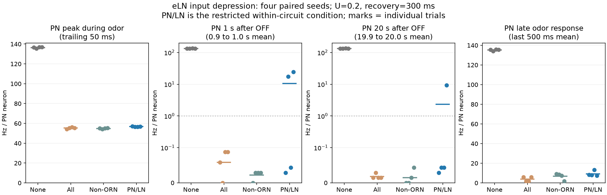
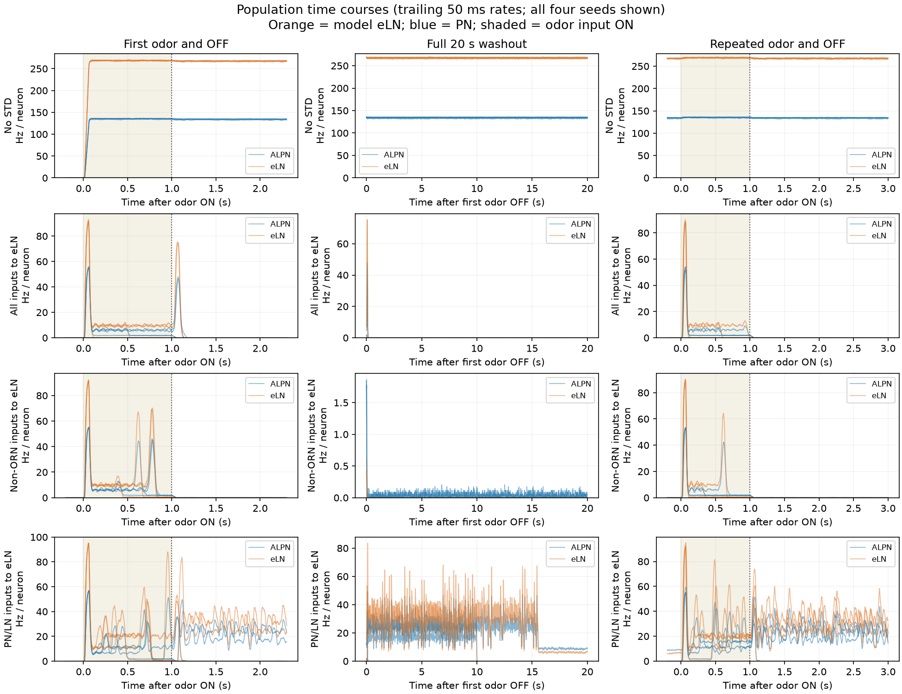

# eLN入力の短期抑圧を回路内へ限定する比較（2026-09-17）

## 問い

前回の全興奮入力への短期抑圧を、eLNに戻る回路内の入力だけへ限定すると、刺激中のPNピークを保ちながら匂いOFF後の残留を減らせるか。ユーザー指定の刺激中ピーク、OFF後1秒、20秒を比較する。ピークが残っても刺激中の応答が早く消える可能性を分けるため、刺激後半の平均と再刺激も併記する。

研究用の別Javaプロセスで測定。稼働中の3Dラボ、本体、2D UI、カタログ、LLM、神経の読出し器は変更していない。上流固定版、元の不応期処理、適応OFF、U=.2、回復300 msは[前回](../brain-std/README.md)と同じ。パラメータは今回調整していない。

## 接続の定義と比較条件

| 条件名 | 短期抑圧の対象 |
|---|---|
| baseline | なし（U=0） |
| all300 | 正符号の全入力 → 正符号ALLN（モデルeLN） |
| internal300 | ORNを除く正符号入力 → モデルeLN |
| local300 | **正符号ALPN・ALLNの入力 → モデルeLN** |

`local300`が回路内を狭く定義した主な確認条件。PNやLNの**eLN以外への出力は直接には変更しない**。同じPNからeLNへの出力は抑圧され得るが、PN自体へ届く入力を直接抑圧する操作ではない。負符号の抑制接続は変更しない。

最初は「ORN以外」を回路内とする3条件を固定した。しかし、接続表に温度・湿度・味覚などの感覚系が含まれると分かったため、初期試行後に`local300`を別の追加プロトコルとして固定した。この追加は結果と無関係に最初から計画されていたとは扱わない。U・回復時間・刺激・評価指標は同じ。`internal300`というファイル名は初期定義の記録として保持する。

- ORNの操作的な集合: `class:ORN`と`prefix:ORN_`の和集合2,635細胞。今回の刺激対象DM1+VA2の157個をすべて含む。データ上のクラス名は主に`olfactory`なので、型名の接頭辞も使う。これは全感覚入力の網羅分類ではない。
- モデルeLNはALLNで正符号の192個（ACh144、不明46、octopamine 2）。確定した生物学的eLN集合とは同一視しない。
- 全正符号入力は37,660接続・819,907接触。そのうちORN由来は18,885接続・191,505接触。
- `local300`は580個の前シナプス細胞からの15,903接続・578,214接触。ALLN由来6,008接続、ALPN由来9,895接続。残りの入力は抑圧しない。
- PN/LNという細胞クラスによる範囲指定であり、全対象接続がグラフ上の閉路に属することを証明したものではない。

[最初のプロトコル](results/protocol.json)・[回路内限定の追加プロトコル](results/local-protocol.json)・[接続群の内訳](results/local300_2026091701-edges.csv)。

## 刺激と測定

各条件4つの同一seed（2026091701、1711、1721、1731）を対にした。前2つは前回も使ったseed、後2つはこの比較で追加。0.5秒無刺激→60 Hzの匂い刺激1秒→OFF20秒→同じ匂い1秒→OFF2秒。dt=.5 ms、gain=.65、KC入力gain=.25、1 worker、spike log無効。独立した試行を最大2プロセスで実行した。

1 msごとに各集団の発火数を記録し、50 msごとのendTickは維持。単位は集団内1細胞あたりのHz。

- **PNピーク**: 1秒の刺激区間に完全に収まる、過去50 ms平均の最大値。10 ms平均の最大値も副指標として保存。窓幅を結果に応じて選び直さない。
- **OFF後1秒**: OFFから0.9〜1.0秒の100 ms平均。
- **OFF後20秒**: OFFから19.9〜20.0秒の100 ms平均。1秒と同じ観測幅。
- 刺激後半: OFF前最後500 msの平均。刺激全体、最後100 ms、OFF直後0〜1秒平均、19〜20秒平均も保存。
- 「0近傍」の説明用基準は平均1 Hz以下。ただし集団平均が低くても個別ニューロンすべてが静止したとは言えない。
- 生理学的な採用基準や「ピークが何%以上なら合格」を後付けせず、対照に対する比率をそのまま報告する。初回・再刺激を分けて比較。

## 結果

**PN/LNからeLNへの入力だけに限定しても、今回のU=.2・300 msでは「刺激中の反応を保ったまま、残留だけを消す」条件にはならなかった。**

### 指定の3値（PN/LN限定）

| seed末尾 | 刺激中PNピーク（50 ms平均） | OFF後1秒PN | OFF後20秒PN | 刺激後半PN（参考） |
|---|---:|---:|---:|---:|
| 1701 | 57.055 | 0.029 | 0.029 | 8.297 |
| 1711 | 56.501 | 17.609 | 0.044 | 8.052 |
| 1721 | 56.501 | 0.044 | 0.044 | 13.163 |
| 1731 | 56.793 | 24.184 | **9.227** | 7.461 |
| 抑圧なし4seedの範囲 | 135.364–136.968 | 133.076–134.723 | 132.843–135.015 | 134.125–135.723 |

Hz/細胞。3/4試行は20秒時点で1 Hz未満だが、1/4は残留。1711は1秒時点でまだ17.6 Hzあり、その後静かになる。1731の19〜20秒全体平均も8.665 Hzなので、20秒の一窓だけをたまたま高く拾った結果ではない。4seedだけで一般的な成功率・信頼区間を主張しない。

### ピークはどれだけ保たれたか

- 50 msピークは同じseedの無抑圧対照の**41.3–41.7%**。
- 副指標の10 msピークは117.930–119.388 Hz、対照の**83.5–85.3%**。立ち上がりの短い山はかなり残るが、50 msにわたる応答は大きく減る。
- 刺激末尾500 msのPNは7.461–13.163 Hz、対照の**5.5–9.7%**。匂いが続く間の応答まで大きく変わっている。

「ピークが残る」を窓幅なしに一つの数字で言うと結論が変わる。このため50 msを主指標、10 msを副指標として事前に固定し、両方を報告した。そもそも無抑圧対照は持続活動の大きいモデルであり、その振幅を保てば生理的に正しいという意味でもない。今回確認できるのは対照に対する変化まで。

### 匂い入力を保っただけでは十分ではない

ORN→eLNの入力倍率は全窓で1.0を維持した。それでもPN後半の発火は低下したため、今回の低下を「直接の匂い入力も抑圧したせい」だけでは説明できない。回路内の興奮を弱めること自体が、刺激中の応答維持にも強く影響している。

より広い「ORN以外」への抑圧では4seedすべて20秒PNが0–0.044 Hzとなったが、ピークは54.169–55.364 Hz、刺激後半は1.834–9.111 Hz。この条件も残留だけを選んで落とせたとは言えない。狭いPN/LN条件との違いは、外した他の入力群が持続活動に関わる候補であることを示すが、個別群の因果同定には追加の比較が必要。

### 再刺激

PN/LN限定でも4seedすべて再刺激の開始に反応した。しかし、再OFF後1秒のPNはseed順に**29.708、21.166、0.058、23.513 Hz**。初回OFFで静かになった条件でも、次回の残留抑制が保証されない。再刺激後の観察は2秒までで、20秒後は今回測定していない。

今回はラボへ採用しない。次の候補は、入力群をさらに分け、匂いの強さ・持続時間・繰り返しに対して、刺激中の表現とOFF後の残留を同時に比較すること。Uや回復時間の数値だけを調整して一つのseedに合わせ込まない。

[指定指標の一覧CSV](results/PN-summary.csv)・[全集計](results/report.json)。図は実測値から生成した。





## 検証

- 最初のビルドで、前回のbaselineと全入力300 msの最初3.5秒について、全記録集団の1 ms発火数が完全一致。[照合](results/equivalence.json)
- 後のビルドで、先の3条件の同じ3.5秒が再び完全一致。追加のモードが既存モードを変えていない。[照合・無刺激対照](results/local-checks.json)
- 同じ標的に収束する入力で、回路内の資源枯渇・指数回復と、繰り返し刺激してもORN入力の強さが変わらないこと、非対象PN出力と抑制の不変を解析式と照合。[全入力](results/StdFixture.txt)・[ORN保護](results/InternalFixture.txt)・[PN/LN限定](results/LocalFixture.txt)
- 全グラフ上で、抑圧する前シナプスの集合が正符号PN/LNで対象eLNへの実接続を持つ細胞と厳密に一致することを確認。[全接続監査](results/SourceSelectionFixture.txt)
- 無入力対照は各条件3.5秒、記録集団の発火・対象入力の送出量とも0。各50 msに全細胞の膜電位の有限値を確認。
- ORN保護条件では、全50 ms窓でORN→eLNの抑圧前後送出量が完全一致。これは伝達倍率の保護であり、ネットワークからの間接作用までなくなることを意味しない。
- 連続時刻、非負発火数、送出量の上下限、集団の包含関係、ピーク計算の人工例と生データのSHA256を検査。[検証](results/validation.json)・[別計算によるPN指標の照合](results/independent-metric-check.json)

## 再実行とファイル

Python標準ライブラリ、JDK25。図のみNumPy・Matplotlib。前回同様、資源Rは発火間に指数回復し、対象入力をR倍した後に`R *= (1-U)`。初回振幅は元のまま。生理に校正した値ではない。数式と資源モデルの参考は[前回の方法](../brain-std/README.md#モデルと固定条件)。

今回の最初の12試行は[初期ビルド記録](provenance/initial/build-metadata.json)、追加4試行は[最終ビルド記録](build-metadata.json)。初期の差分・実行ラッパーも`provenance/initial/`に保存。最終コードは両方のモードを含み、既存モードの一致は上の照合で確認済み。[ソース差分](lif-std.patch)

```sh
python3 tools/fly-body-lab/brain-internal-std/build.py \
  --upstream .fly-research/upstream/blendi-remade--fly-brain-minecraft \
  --output /tmp/fly-internal-build --jdk /path/to/jdk/bin
python3 tools/fly-body-lab/brain-internal-std/run.py \
  --build /tmp/fly-internal-build --java /path/to/jdk/bin/java \
  --data .fly-research/upstream/blendi-remade--fly-brain-minecraft/src/main/resources/connectome/malecns-v1.0.flyb.gz \
  --previous tools/fly-body-lab/brain-std/results --out /tmp/fly-internal-results
python3 tools/fly-body-lab/brain-internal-std/run_local.py \
  --build /tmp/fly-internal-build --java /path/to/jdk/bin/java \
  --data .fly-research/upstream/blendi-remade--fly-brain-minecraft/src/main/resources/connectome/malecns-v1.0.flyb.gz \
  --out /tmp/fly-internal-results
python3 tools/fly-body-lab/brain-internal-std/analyze.py /tmp/fly-internal-results
python3 tools/fly-body-lab/brain-internal-std/plot.py /tmp/fly-internal-results
```

`spikes.csv`は1 ms内の実発火数、`synapses.csv`は50 ms内の興奮送出量（抑圧前後のg加算量、実測電流ではない）。`edges.csv`は抑圧の候補となる全正符号→eLN接続の内訳であり、行すべてに抑圧を適用した意味ではない。対象は条件の定義に従う。生データ・ログ・集計は`results/`。
