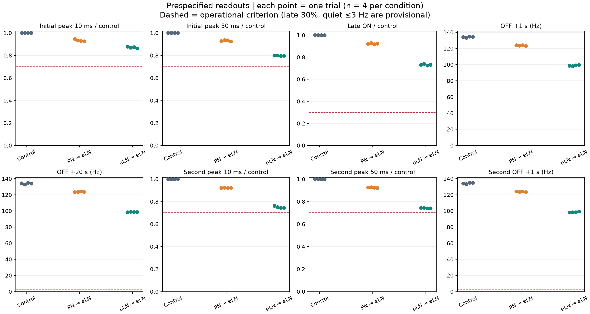
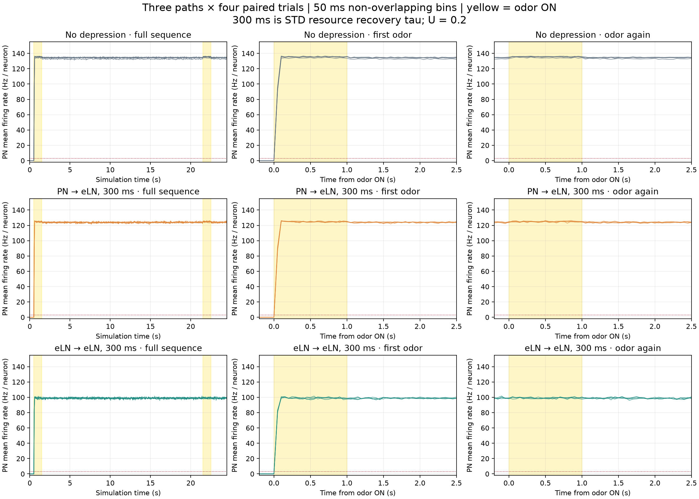

# 3条件 × 各4試行の結果

全値はPN 686細胞の平均発火率（Hz / neuron）、4試行の最小〜最大。点測定ではなく指定窓の平均。

| 指標（測定順） | 抑圧なし | PN→eLNのみ | eLN→eLNのみ |
|---|---:|---:|---:|
| 初回ピーク10 ms | 139.94〜141.25 | 130.47〜132.80 | 121.57〜123.32 |
| 初回ピーク50 ms | 135.36〜136.97 | 126.56〜127.96 | 108.37〜109.27 |
| 刺激後半500 ms | 134.13〜135.72 | 124.48〜124.95 | 98.43〜99.20 |
| OFF後1秒 | 133.08〜134.72 | 123.16〜124.13 | 98.31〜99.68 |
| OFF後20秒 | 132.84〜135.01 | 123.41〜124.24 | 98.40〜99.04 |
| 再刺激ピーク10 ms | 140.09〜141.11 | 129.45〜130.03 | 105.10〜107.43 |
| 再刺激ピーク50 ms | 136.09〜137.00 | 126.03〜126.62 | 101.14〜101.60 |
| 再OFF後1秒 | 133.28〜134.97 | 123.40〜124.36 | 98.22〜99.45 |

同seedの対照との比率（%）。各試行の比を計算してから範囲を出す。

| 指標 | PN→eLNのみ | eLN→eLNのみ |
|---|---:|---:|
| 初回ピーク10 ms | 92.7〜94.6% | 86.3〜87.9% |
| 初回ピーク50 ms | 92.4〜93.6% | 79.5〜80.1% |
| 刺激後半500 ms | 91.8〜92.8% | 72.5〜74.0% |
| 再刺激ピーク10 ms | 92.0〜92.4% | 74.5〜76.2% |
| 再刺激ピーク50 ms | 92.2〜92.9% | 74.0〜74.4% |

## 実行前に固定した判定の通過数

| 判定 | 抑圧なし | PN→eLNのみ | eLN→eLNのみ |
|---|---:|---:|---:|
| 初回ピーク両窓 ≥70% | 4/4 | 4/4 | 4/4 |
| 刺激後半 ≥30% | 4/4 | 4/4 | 4/4 |
| OFF1秒 ≤3 Hz | 0/4 | 0/4 | 0/4 |
| OFF20秒 ≤3 Hz | 0/4 | 0/4 | 0/4 |
| 再刺激ピーク両窓 ≥70% | 4/4 | 4/4 | 4/4 |
| 再刺激50 msピーク > 直前OFF20秒値 | 4/4 | 4/4 | 4/4 |
| 再OFF1秒 ≤3 Hz | 0/4 | 0/4 | 0/4 |
| 全項目同時に通過 | 0/4 | 0/4 | 0/4 |

30%・3 Hzは暫定基準。再刺激ピークが高くても、直前に静まっていなければ「一度静まり、再び応答した」とは判定できない。20秒の再OFF観測は今回の範囲外。

## 各試行

[PNの全数値](PN-summary.csv) · [全観測集団と判定](report.json) · [固定プロトコル](protocol.json) · [独立再計算](independent-metric-check.json)

