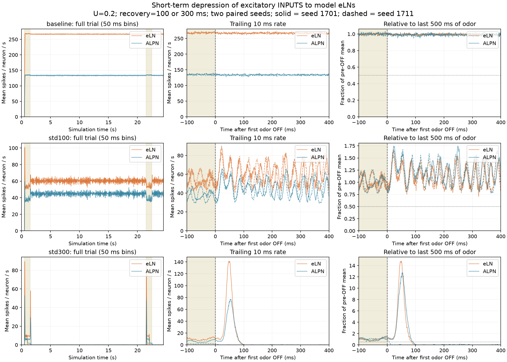
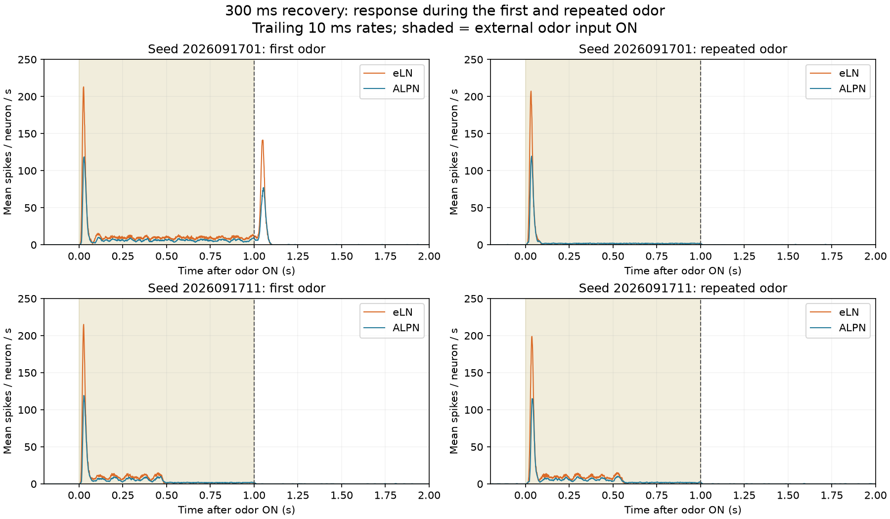

# eLNへ入る興奮性シナプスの短期抑圧（2026-09-17）

## 問いと範囲

eLNへの興奮性入力に使用依存の短期シナプス抑圧を入れると、匂いOFF後にeLNがPNより先に低下するか。稼働中のラボとは別プロセスで比較した。eLN→PN出力の直接抑圧ではない。元の接続データとラボ、本体、2D UI、LLM配線は変更していない。

前回の不応期変更や閾値適応とは組み合わせず、上流の元の計算に短期抑圧だけを追加した。元実装にある不応期中の入力保持、強制Poisson刺激、伝達物質の符号割当などの制約は引き継ぐ。この実験だけで実ハエの生理を再現したとは扱わない。

## モデルと固定条件

資源Rを1から開始し、発火間隔Δtごとに `R_before = 1 - (1 - R_after_previous) exp(-Δt/τ)` と回復させる。対象接続の入力振幅をR_before倍し、発火後に `R_after = R_before (1-U)` とする。初回の強さは元のモデルと同じ。促通は入れない。これは資源枯渇・回復型の簡略モデルで、放出振幅にさらにUを乗算する定式化とは初回振幅の正規化が異なる。

資源枯渇モデルの参考は[Tsodyks & Markram (1997)](https://pubmed.ncbi.nlm.nih.gov/9012851/)。同論文は皮質シナプスの研究であり、今回のハエeLNのUやτを裏づける測定ではない。**U=.2、τ=100/300 msは仮説を試す設定で、生理学的な校正値ではない。** 結果を見て調整していない。

- 対象: モデルのALLNかつ正符号の192細胞へ入る、正符号の前シナプスからの37,660接続（819,907接触）。AChラベル144、不明46、octopamine 2。全192個を生物学的に確定したeLNと呼ばない。AChと不明群は別々にも集計。
- 同じ前シナプス由来の対象接続は、同じ初期値・U・τ・発火履歴を持つため、資源状態を共有して計算する。対象接続ごとに独立に同じ式を回す場合と同値。接続ごとに資源を二重に消費しない。非対象PNへの出力と負符号の抑制入力は元のまま。
- baseline: U=0。STD: U=.2、回復時定数100 ms / 300 ms。各条件seed 2026091701、2026091711の2試行。
- quiet .5秒→DM1+VA2 ORN157個へ60 Hzを1秒→OFF20秒→再刺激1秒→OFF2秒。
- dt .5 ms、gain .65、KC入力gain .25、1 worker、spike log無効。条件間で刺激乱数列を共用。
- 抑圧は開始時から常に作用する。OFFを合図に重みを落としたり、神経状態・資源をリセットしたりしない。

[実行前プロトコル](results/protocol.json)・[上流とデータの固定ハッシュ](build-metadata.json)・[一時ビルドへの差分](lif-std.patch)。

## 低下順序の測り方

1 msごとの実発火数を保存。元実装のendTickは50 msごとのまま維持し、その間は累積発火数の差分を記録する。eLN192、PN686など各集団の1細胞あたりの発火率を求める。

OFF前末尾500 msの平均を各集団の基準とする。同一の過去10 ms移動平均が基準の50%以下になり、20 ms連続して維持した最初の時刻を半減時刻とする。1 Hz以下の100 ms持続も別に検査。OFF直前が1 Hz未満なら床効果として時刻を判定しない。最初と再刺激後のOFFを別々に測る。

時刻は窓の終端、OFFからのms。低下開始・指数減衰時定数そのものではない。1 msの記録と10 msの平滑化、集団平均と閾値選択に依存するため、数msの先行や相関だけから因果を断定しない。一度下がった後の再上昇も確認する。

## 結果

**回復300 msでは高い持続活動を解消できた。ただし、eLNがPNより先に落ちる順序は安定して再現せず、刺激中にも反応が消える条件だった。**

| 条件 | PN 刺激末尾 | PN OFF後1〜2秒 | PN OFF後19〜20秒 | eLN OFF後19〜20秒 |
|---|---:|---:|---:|---:|
| 抑圧なし | 134.13–135.52 | 132.70–134.26 | 132.68–134.42 | 266.29–267.52 |
| 回復100 ms | 37.77–37.82 | 44.43–44.64 | 44.81–45.06 | 60.18–60.57 |
| 回復300 ms | 1.76–6.05 | 0.029–0.038 | 0.029–0.036 | 0 |

Hz/細胞、2seedの範囲。刺激末尾は最後500 ms。100 msでは刺激中よりOFF後の平均が高くなり、周期的な変動も残った。300 msではPNの残留は低いが完全なゼロではない。

### OFF直後の順序

- 300 ms・seed1701の最初のOFF: 一度大きな発火の山を経て、eLNは88 ms、PNは92 msで50%基準を下回った。AChだけを見てもeLNの半減時刻は88 ms。差は4 ms。
- ただし1 Hz基準ではPNが98 ms、eLNが99 ms。順序は指標により逆になる。10 ms平滑化を用いた集団指標の4 ms差を、強い因果の証拠にしない。
- 300 ms・seed1711の最初のOFF: **eLNは匂いが続いている間に静かになり、OFF前末尾500 msの発火が既に0**。OFF後の半減順序は判定できない。PNは8 msで半減基準を下回った。
- 再刺激後もseed1701のeLNはOFF前から0。seed1711は数値上半減1 msだが、OFF前から20 ms以上その閾値以下だったため「OFFが引き起こした先行低下」と扱わない。
- 抑圧なしと100 msは、最初のOFF20秒・再OFF2秒のどちらでもeLN/PNが規定の半減条件を満たさない。

### 再刺激と抑圧の強さ

300 msでも2seedとも再刺激の開始にeLN/PNの発火の山は生じる。しかし、その後eLNは**まだ匂いが出ている間に静かになる**。eLNの再刺激1秒平均は初回の34%と106%、PNは53%と103%で、応答の持続時間もseedに依存した。単に回路が二度と反応できなくなったわけではないが、安定した持続臭の表現が回復したとは言えない。

対象接続への興奮送出量（抑圧後/抑圧前）は、最初の刺激末尾で100 msが20.7–20.9%、300 msが9.4–12.7%。1発ごとのU=.2でも、繰り返し発火下ではかなり強い抑圧になっている。300 msのOFF末尾では29.5–32.7%であり、eLNの沈静化を「全前シナプスも止まり資源が完全に回復した」とは解釈できない。

今回確認できたのは、**このモデルのeLN向け興奮入力へ使用依存の抑圧を加えることで、高いPN残留を維持できない条件を作れる**こと。生理的なパラメータ同定、正常な嗅覚、eLN→PNという一方向の因果順序の証明ではない。稼働ラボへは採用していない。次の課題は、刺激中の反応を保つ条件があるか、受容体由来入力と再帰的な入力への抑圧を分けて比較すること。

[全集計](results/report.json)。比較図は実測CSVから生成。図の橙=eLN、青=PN。OFF拡大図の実線=seed1701、破線=seed1711。





## 検証と再実行

- 人工の接続で、連続発火による抑圧、指数回復、複数の対象への同じ倍率、非対象PNと抑制入力の不変を解析式と照合。[検証ログ](results/fixture.txt)
- U=0の新しい1 ms記録を50 msへ足し戻し、前回のbaselineの最初3.5秒・70窓、ORN/eLN/PN/GABA LNの全280値を照合。[一致結果](results/baseline_equivalence.json)
- 3条件とも最初から無刺激なら、3.5秒間の測定集団の発火と対象接続の興奮送出量は0。[無入力対照](results/zero_controls.json)
- 各50 msに全膜電位の有限値を確認。保存したCSVの連続時刻、発火数の非負、送出量が元の量以下、baseline送出量の不変、半減時刻判定の小例を検査。[検証・SHA256](results/validation.json)

Python標準ライブラリとJDK 25。描画のみNumPyとMatplotlibを使う。研究リポジトリのルートから、まだ存在しない出力ディレクトリを指定する。

```sh
python3 tools/fly-body-lab/brain-std/build.py \
  --upstream .fly-research/upstream/blendi-remade--fly-brain-minecraft \
  --output /tmp/fly-std-build --jdk /path/to/jdk/bin
python3 tools/fly-body-lab/brain-std/run.py \
  --build /tmp/fly-std-build \
  --data .fly-research/upstream/blendi-remade--fly-brain-minecraft/src/main/resources/connectome/malecns-v1.0.flyb.gz \
  --java /path/to/jdk/bin/java \
  --previous tools/fly-body-lab/brain-factorial/results/factorial/baseline_2026091701-windows.csv \
  --out /tmp/fly-std-results
python3 tools/fly-body-lab/brain-std/analyze.py /tmp/fly-std-results
python3 tools/fly-body-lab/brain-std/plot.py /tmp/fly-std-results
```

`*-spikes.csv`は1 ms内の発火**数**、Hzではない。`*-synapses.csv`は50 ms内の対象接続への興奮送出量で、抑圧前後のg加算量の合計。到来時の受入量や実測電流ではない。`report.json`は母数で正規化したHz/細胞を用いる。生データと試行ログを同梱した。
