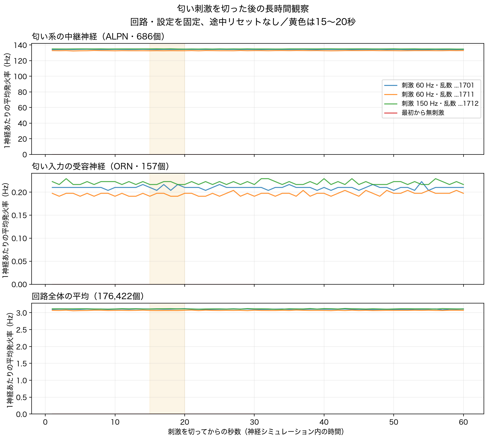

# 匂い刺激OFF後の長時間観察（2026-09-17）

## 結果

3つの刺激試行すべてで、外部入力を切って60秒後までALPN活動が高いまま続いた。15〜20秒で自然に減衰するという見込みは、今回のモデル・刺激条件では確認できなかった。最初から無刺激の対照は31.5秒間、全回路で発火0。永久持続の証明ではない。

| 試行 | 刺激 Hz | OFF後2秒 | 20秒 | 60秒 | 最後5秒のORN |
|---|---:|---:|---:|---:|---:|
| 2026091701_60 | 60 | 134.258 | 134.417 | 134.322 | 0.210 |
| 2026091711_60 | 60 | 132.701 | 132.676 | 132.910 | 0.199 |
| 2026091712_150 | 150 | 134.910 | 134.771 | 134.778 | 0.222 |
| 2026091713_0 | 0 | 0.000 | 0.000 | 未観測 | 0.000 |

表の2/20/60秒はその時点で終わる1秒間のALPN集団平均発火率（Hz/神経）。ORN列は刺激対象157個の最後5秒の平均。ALPNは686個。カルシウム応答ではなく、生の発火回数から計算した。



[全測定CSV](results/dataset.csv)・[1秒集計と判定](results/report.json)・[生成条件とハッシュ](results/metadata.json)・[他実装とGrok情報の照合](COMPARISON.md)

## 方法と判定

- 上流Java4クラスとMaleCNSデータは固定版・無改変を照合して実行。回路の重み・適応・抑制・時間刻みは変更していない。
- dt=.5 ms、gain=.65、KC入力gain=.25、1 worker。ORN_DM1+ORN_VA2へ0.5秒静穏→1秒刺激→入力を完全に切る。
- 最初に30秒観察し、直近5秒の全50ms窓でALPN平均が1Hz以下になっていなければ、回路をリセットせず60秒まで延長。条件は実行前の[protocol.json](results/protocol.json)に記録。対照は30秒観察段階で終了。
- 前回のseed1701/60Hz、別seed1711/60Hz、seed1712/150Hz、無刺激seed1713。乱数はPoisson入力の時刻を変えるもので、無作為な神経集団への刺激ではない。
- 初期化は試行間だけ。50msごとに実発火率を測定し、窓のカウンターのみ消去。ORN・ALPN・KC・各運動系・全神経を記録。
- 「刺激中最後500msのALPN平均の半分以下」「1Hz以下」が5つの連続した1秒平均で続く時点を集計。3つの刺激試行ではどちらも未到達。これは工学上の閾値で、生物の記憶消失や全神経の無活動を意味しない。
- 減衰が確認できなかったため、停止時間を絞る追加試験や停止するような係数調整は実施していない。

## 検証

4,320窓、実行568.19秒、非有限な膜状態0。刺激区間・入力解除・連続時刻・試行数を検査。前回1701/Aの最初3.5秒に対応する70窓×8集団の560測定値は完全一致した。[照合記録](results/prefix-reproduction.json)。集計のテスト4件通過。コードの独立レビューで入力時刻・状態維持・窓内計数を確認。グラフは実測から生成し、目視確認した。

## 再実行

Python標準ライブラリとJDK 25。研究リポジトリのルートで、未作成の出力先を指定する。

```sh
python3 tools/fly-body-lab/brain-washout/run.py \
  --upstream .fly-research/upstream/blendi-remade--fly-brain-minecraft \
  --output .fly-research/washout/new-run \
  --jdk /path/to/jdk/bin
python3 tools/fly-body-lab/brain-washout/analyze.py .fly-research/washout/new-run
python3 -m unittest discover -s tools/fly-body-lab/brain-washout -p test_analysis.py
```

グラフの再生成だけはMatplotlibを使う（今回3.11.2）。ラボの実行環境とは分けた一時環境で描画した。

```sh
python3 tools/fly-body-lab/brain-washout/plot.py .fly-research/washout/new-run
```

これは同じ一標本・固定モデル内の限定試験。生きたハエの匂い記憶、すべての匂い・入力強度での挙動、正確な原因を証明しない。動作中のラボ、本体、LLM接続は変更していない。
