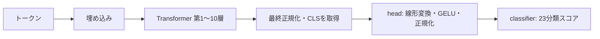

> 公開整理（2026-10-23）：以下は当時の記録です。「現在」「未実施」「採用」や実行例は記録時点を指します。後続の訂正・採用状況は[試行錯誤](../../試行錯誤.md)を参照してください。未収録のファイルは実験元の参照として表記しています。

# 層を交換しながら分類への影響を調べる（2026-10-22）

**新モデルを基に、第8層だけ旧モデルへ戻すと62/79件・macro F1 0.8343。新モデルが正解していた60件をすべて維持し、2件を改善した。** 第3・第5・第8層を戻すと63/79件・0.8554まで上がるが、敵情報・乗り物などで取りこぼしが生じた。

層番号は入力側から第1〜10層。コード上の `layer 0〜9` と1つずれる。全体平均の合成に加え、1部分ずつの双方向交換と、結果に基づく組合せを試した。**測ったのは各部分の交換が分類へ与える影響で、「剣の知識はこの層だけにある」と特定したものではない。**

後続の[最終23分類層を固定したTIES比較](2026-10-22-colab-23class-ties-merging.md)では、9構成の正解数最多61/79・macro F1最高0.8277で、第8層交換版を上回らなかった。

さらに[第8層交換版をtest78件で評価](2026-10-22-colab-23class-layer8-test.md)すると、新モデルと同じ60/78・macro F1 0.7288。乗り物1件を改善し、敵情報1件が悪化した。以下の「新たな誤り0件」はdevに限る。

## 実際のモデル配置

保存されたconfig・66テンソルと、実際に使ったTransformersのforward実装を確認した。隠れ状態は256次元、Transformerは10層、出力は23分類。



| 部分 | 保存重みの場所 | パラメーター数 | 今回の扱い |
|---|---|---:|---|
| 埋め込み | `model.embeddings.*` | 26,214,656 | 一つの部分として交換 |
| 第1層 | `model.layers.0.*` | 1,048,832 | 注意・MLP・正規化を一緒に交換 |
| 第2〜10層 | `model.layers.1.*`〜`9.*` | 各1,049,088 | 層ごとに同様に交換 |
| 最終正規化 | `model.final_norm.*` | 256 | 単独交換 |
| 分類前の変換 | `head.dense.weight`・`head.norm.weight` | 65,792 | まとめて交換 |
| 最後の分類器 | `classifier.weight`・`classifier.bias` | 5,911 | 23分類全体を交換 |

合計36,777,239パラメーター。第1・4・7・10層は全域attention、それ以外は局所attentionの設定。ただし今回のdevは最大28 tokenで局所窓128以内のため、窓幅を原因とする性能差を切り分けた実験ではない。

全テンソルと層の対応・重み変化量（未収録・実験元参照: `../diagnostics/v4-pilot650-layer-swaps/layer-map.json`） ／ 使用実装のforward抜粋（未収録・実験元参照: `../diagnostics/v4-pilot650-layer-swaps/architecture-forward-source.txt`）

## 試行手順

1. **単独交換30評価**：旧・新の基準2本と、14部分を旧→新／新→旧の両方向に一つずつ交換した28本。変更した部分以外は基準モデルの重みを保つ。
2. **組合せ20評価**：単独交換後にレシピを固定。第3・5・8・9層等の併用、部分的な50%合成、前半・中盤・後半のまとめ交換を比較した。
3. **再照合・再推論**：50評価の全3,950予測を独立集計。保存した4候補の重みを式と再照合し、第8層版と第3・5・8層版を再読込み・再推論して79件ずつの確率・予測を完全再現した。

全モデルを同じCPU・float32・SDPA・batch16で評価。入力は既存dev79件だけで切り詰めなし。追加学習とtest評価は0回。

## どの部分で境界が動いたか

| 交換条件 | 確認できた変化 |
|---|---|
| 旧モデルの第1層だけ新へ | ドギド呼び寄せ2→3件、左向き0→1件。ただしプレイヤー注視3→2件などが悪化。接近・注視・方向の境界が動いた |
| 旧モデルの第3層、または第10層だけ新へ | 剣の正解が各1/5→3/5。他分類の変化も伴う |
| 新モデルの第8層だけ旧へ | 60→62件。村人の人数質問を対象外へ、川柳の下の行指定を行指定へ戻し、新たな誤りは0件 |
| 新モデルの第3層だけ旧へ | 川柳の下の行指定と「今日の冒険は終了しましょうか」を改善。一方、熱帯魚の人数質問が悪化。61/79件 |
| 新モデルの第10層だけ旧へ | 60→57件。川柳終了・対象外・遠景の各1件が悪化 |
| 新モデルのheadだけ旧へ | 60→57件。対象外・遠景・川柳の上の行指定が悪化 |
| 最終正規化だけ交換 | 両方向とも79件の予測ラベルに変化なし |
| 最後のclassifierだけ交換 | 新モデル側では予測ラベルに変化なし。旧モデル側は2件改善 |

**同じ層でも周囲の重みで作用が変わる。** 旧モデルの第3層を新にすると剣は1→3件へ改善するが、新モデルの第3層を旧へ戻しても剣5/5を維持する。今回の観測は、能力を層単位の独立した部品として扱えないことを示している。

全28交換の23分類ごとのTP・FP変化は[単独交換の結果](../diagnostics/v4-pilot650-layer-swaps/report.md)、全20組合せは[組合せ結果](../diagnostics/v4-pilot650-layer-combinations/report.md)。

## 良かった構成と代償

以下はすべてdev79件。

| 構成 | 正解数 | macro F1 | 新モデル単独からの改善 / 新しい誤り |
|---|---:|---:|---:|
| 旧モデル | 56/79 | 0.7463 | — |
| 新モデル | 60/79 | 0.8192 | — |
| 前回の全層50%合成 | 61/79 | 0.7815 | 3 / 2 |
| **新モデル＋第8層を旧** | **62/79** | **0.8343** | **2 / 0** |
| 新モデル＋第5・8層を旧 | 63/79 | 0.8451 | 4 / 1 |
| 新モデル＋第1・3・8層を旧 | 63/79 | 0.8506 | 4 / 1 |
| **新モデル＋第3・5・8層を旧** | **63/79** | **0.8554** | **6 / 3** |

### 第8層だけ戻した構成

- 「村人は何人いる？」：敵情報→正しい対象外。
- 「うーんと。。。下の句・・・変えませんか？」：チェンジ→正しい行指定。
- 剣5/5・乗り物5/5・ドギド呼び寄せ3/3を維持。ドギドへの誤検出2件と、プレイヤー注視2/3は残る。

今回のdevでは、新モデルの成功例を保ちながら改善できた候補として扱える。

### 第3・5・8層を戻した構成

入力からの順番は次のとおり。埋め込み、最終正規化、head、classifierは新モデルのまま。

| 人間向けの層番号 | 1 | 2 | 3 | 4 | 5 | 6 | 7 | 8 | 9 | 10 |
|---|---|---|---|---|---|---|---|---|---|---|
| コード上の番号 | 0 | 1 | 2 | 3 | 4 | 5 | 6 | 7 | 8 | 9 |
| 重みの出所 | 新 | 新 | **旧** | 新 | **旧** | 新 | 新 | **旧** | 新 | 新 |

macro F1は今回最大。川柳の行指定を4件、対象外を2件改善した。一方、「背後にクリーパーはいそう？」を遠景、「剣は替えなくていいから、馬を呼んで。」を対象外、「熱帯魚は何匹いる？」を敵情報へ誤分類した。最高の全体指標だけで採用を決める結果ではない。

## 全23分類の比較

各セルは **正解数 / 誤検出数**。誤検出は他の分類から流入した件数。

| 分類 | 正例数 | 新モデル | 第8層だけ旧 | 第3・5・8層を旧 |
|---|---:|---:|---:|---:|
| 対象外・雑談 | 9 | 3 / 1 | 4 / 1 | 4 / 2 |
| 敵情報 | 5 | 4 / 2 | 4 / 1 | 3 / 3 |
| 剣への持ち替え | 5 | 5 / 0 | 5 / 0 | 5 / 0 |
| 乗り物呼び出し | 5 | 5 / 1 | 5 / 1 | 4 / 1 |
| ドギド呼び寄せ | 3 | 3 / 2 | 3 / 2 | 3 / 2 |
| 川柳・上の行指定 | 6 | 5 / 0 | 5 / 0 | 6 / 0 |
| 川柳・中の行指定 | 6 | 3 / 0 | 3 / 0 | 4 / 0 |
| 川柳・下の行指定 | 8 | 4 / 0 | 5 / 0 | 6 / 0 |
| 川柳・上のチェンジ | 3 | 3 / 1 | 3 / 1 | 3 / 0 |
| 川柳・中のチェンジ | 3 | 3 / 3 | 3 / 3 | 3 / 2 |
| 川柳・下のチェンジ | 4 | 4 / 4 | 4 / 3 | 4 / 2 |
| 同じ遠景を見る | 6 | 3 / 0 | 3 / 0 | 3 / 1 |
| 川柳終了 | 3 | 3 / 1 | 3 / 1 | 3 / 0 |
| 右を見る | 1 | 1 / 0 | 1 / 0 | 1 / 0 |
| 十字マークの対象を見る | 2 | 2 / 1 | 2 / 1 | 2 / 0 |
| プレイヤーを見る | 3 | 2 / 2 | 2 / 2 | 2 / 2 |
| 前を見る | 1 | 1 / 0 | 1 / 0 | 1 / 0 |
| 後ろを見る | 1 | 1 / 1 | 1 / 1 | 1 / 1 |
| 左を見る | 1 | 1 / 0 | 1 / 0 | 1 / 0 |
| 左斜め前を見る | 1 | 1 / 0 | 1 / 0 | 1 / 0 |
| 右斜め前を見る | 1 | 1 / 0 | 1 / 0 | 1 / 0 |
| 左斜め後ろを見る | 1 | 1 / 0 | 1 / 0 | 1 / 0 |
| 右斜め後ろを見る | 1 | 1 / 0 | 1 / 0 | 1 / 0 |

## 保存・再現・確認範囲

- 第8層版：保存モデル設定（未収録・実験元参照: `../diagnostics/v4-pilot650-layer-swaps/weights/new-swap-layer-07/config.json`）。
- 第3・5・8層版：保存モデル設定（未収録・実験元参照: `../diagnostics/v4-pilot650-layer-combinations/weights/new-old-l02-l04-l07/config.json`）。
- 全50評価の新モデルとの比較（未収録・実験元参照: `../diagnostics/v4-pilot650-layer-replay/all-candidates-vs-new.json`） ／ 独立集計と保存モデル再推論（未収録・実験元参照: `../diagnostics/v4-pilot650-layer-replay/verification.json`）。
- 重みはローカル保存。元の新旧モデル、dev、既存採用設定のハッシュは維持。本体採用は未実施。
- 多数の構成を既知のdevで比較した開発結果で、未知発話での改善は未確認。特に方向分類は各1件、川柳の改善には同じ文型の派生例が含まれる。

単独交換の再実行は、新しい出力先を指定する。

```bash
$DOGIDO_ROOT/.dogido_tools/request_classifier/.venv/bin/python inspect_layer_merges.py --output-dir diagnostics/layer-swaps-rerun
```

組合せの再実行:

```bash
$DOGIDO_ROOT/.dogido_tools/request_classifier/.venv/bin/python inspect_layer_merges.py --output-dir diagnostics/layer-combinations-rerun --recipes diagnostics/v4-pilot650-layer-combination-plan.json
```
