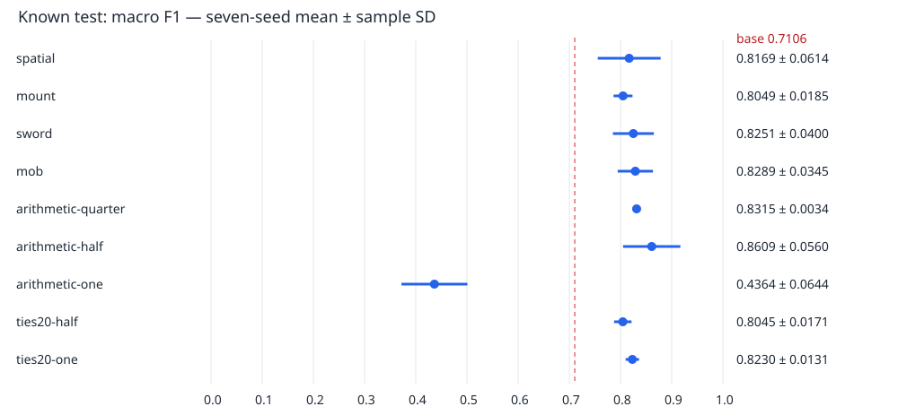

# 通常対話・4系統×7seedの結果

**既知の診断データによる比較。未知の実機精度ではありません。**

28本は同じseed43 checkpointからの追加学習。7seedは学習順等の反復であり、7種類の基盤初期化ではありません。

学習28本、4系統合成35本、同方式の7seed重み平均9本、元モデル1本の計73候補を比較しました。

## devで固定した選択

| 区分 | モデル |
|---|---|
| 総合 | seed48-mob |
| 学習単体 | seed48-mob |
| 4系統の合成 | seed43-ties20-half |
| 7seedの平均dev成績で選んだ方式 | ties20-half |
| その方式の7seed重み平均 | mean7-ties20-half |

最後の重み平均モデルは別途実測しています。7seedの点数の平均と同じとは限りません。自動的な本体採用は行いません。

## 選択モデルと元モデル

| モデル | dev正解/46 | dev F1 | test正解/50 | test F1 | 元から改善 | 新たな誤り |
|---|---:|---:|---:|---:|---:|---:|
| base-seed43 | 39 | 0.8930 | 41 | 0.7106 | 0 | 0 |
| seed48-mob | 42 | 0.9428 | 45 | 0.8107 | 5 | 1 |
| seed43-ties20-half | 42 | 0.9291 | 44 | 0.7873 | 3 | 0 |
| mean7-ties20-half | 41 | 0.9188 | 45 | 0.8114 | 4 | 0 |

## 7seedの平均と標本標準偏差

平均±標本SD。すべてのseedを含みます。元モデルは1本なので反復のSDは付けません。

| 系統・合成方式 | dev macro F1 | test macro F1 | test正解率 |
|---|---:|---:|---:|
| spatial | 0.9036 ± 0.0120 | 0.8169 ± 0.0614 | 89.43% ± 2.23 pt |
| mount | 0.9042 ± 0.0134 | 0.8049 ± 0.0185 | 90.00% ± 1.63 pt |
| sword | 0.9142 ± 0.0151 | 0.8251 ± 0.0400 | 90.29% ± 2.69 pt |
| mob | 0.9155 ± 0.0174 | 0.8289 ± 0.0345 | 91.14% ± 2.54 pt |
| arithmetic-quarter | 0.9112 ± 0.0088 | 0.8315 ± 0.0034 | 92.29% ± 0.76 pt |
| arithmetic-half | 0.8638 ± 0.0105 | 0.8609 ± 0.0560 | 89.71% ± 3.35 pt |
| arithmetic-one | 0.5720 ± 0.0789 | 0.4364 ± 0.0644 | 45.14% ± 6.52 pt |
| ties20-half | 0.9203 ± 0.0039 | 0.8045 ± 0.0171 | 89.14% ± 1.95 pt |
| ties20-one | 0.8938 ± 0.0122 | 0.8230 ± 0.0131 | 91.43% ± 0.98 pt |

## 系統別の正解数と誤流入（test）

各欄は正解数/正例数、括弧内は他系統を誤ってこの系統へ分類した件数。視線内部の取り違えも不正解に含みます。

| モデル | spatial | mount | sword | mob | other |
|---|---|---|---|---|---|
| base-seed43 | 17/23（誤流入0） | 7/7（誤流入1） | 6/6（誤流入0） | 5/6（誤流入1） | 6/8（誤流入2） |
| seed48-mob | 20/23（誤流入0） | 7/7（誤流入0） | 5/6（誤流入0） | 5/6（誤流入0） | 8/8（誤流入2） |
| seed43-ties20-half | 19/23（誤流入0） | 7/7（誤流入1） | 6/6（誤流入0） | 5/6（誤流入0） | 7/8（誤流入2） |
| mean7-ties20-half | 20/23（誤流入0） | 7/7（誤流入1） | 6/6（誤流入0） | 5/6（誤流入0） | 7/8（誤流入1） |

## 学習内の確認

共有818件のうち今回の追加336件もすべてtrainです。以下は汎化の成績ではありません。

| モデル | train正解/818 | 追加336件の正解 |
|---|---:|---:|
| base-seed43 | 711 | 229/336 |
| seed48-mob | 811 | 329/336 |
| seed43-ties20-half | 806 | 324/336 |
| mean7-ties20-half | 806 | 324/336 |

## 全73候補

順番は実行前の候補順です。testを使って係数やseedを選び直していません。

| モデル | dev正解 | dev F1 | test正解 | test F1 |
|---|---:|---:|---:|---:|
| base-seed43 | 39/46 | 0.8930 | 41/50 | 0.7106 |
| seed42-spatial | 40/46 | 0.8922 | 45/50 | 0.7977 |
| seed42-mount | 41/46 | 0.9110 | 45/50 | 0.8123 |
| seed42-sword | 41/46 | 0.9160 | 47/50 | 0.8391 |
| seed42-mob | 42/46 | 0.9324 | 44/50 | 0.7957 |
| seed42-arithmetic-quarter | 41/46 | 0.9172 | 46/50 | 0.8302 |
| seed42-arithmetic-half | 40/46 | 0.8759 | 44/50 | 0.8422 |
| seed42-arithmetic-one | 32/46 | 0.6884 | 28/50 | 0.5134 |
| seed42-ties20-half | 41/46 | 0.9188 | 44/50 | 0.8050 |
| seed42-ties20-one | 40/46 | 0.8910 | 46/50 | 0.8302 |
| seed43-spatial | 40/46 | 0.9091 | 44/50 | 0.7886 |
| seed43-mount | 42/46 | 0.9272 | 44/50 | 0.7790 |
| seed43-sword | 40/46 | 0.8921 | 46/50 | 0.9053 |
| seed43-mob | 41/46 | 0.9047 | 44/50 | 0.7937 |
| seed43-arithmetic-quarter | 42/46 | 0.9214 | 46/50 | 0.8302 |
| seed43-arithmetic-half | 38/46 | 0.8536 | 47/50 | 0.9407 |
| seed43-arithmetic-one | 20/46 | 0.5771 | 20/50 | 0.4741 |
| seed43-ties20-half | 42/46 | 0.9291 | 44/50 | 0.7873 |
| seed43-ties20-one | 40/46 | 0.8863 | 46/50 | 0.8302 |
| seed44-spatial | 41/46 | 0.9099 | 46/50 | 0.8225 |
| seed44-mount | 41/46 | 0.9047 | 46/50 | 0.8302 |
| seed44-sword | 41/46 | 0.9011 | 45/50 | 0.8219 |
| seed44-mob | 40/46 | 0.8902 | 46/50 | 0.8941 |
| seed44-arithmetic-quarter | 41/46 | 0.9011 | 46/50 | 0.8302 |
| seed44-arithmetic-half | 38/46 | 0.8515 | 42/50 | 0.8237 |
| seed44-arithmetic-one | 16/46 | 0.4333 | 18/50 | 0.3577 |
| seed44-ties20-half | 41/46 | 0.9188 | 45/50 | 0.8114 |
| seed44-ties20-one | 41/46 | 0.9035 | 46/50 | 0.8302 |
| seed45-spatial | 41/46 | 0.8991 | 43/50 | 0.7558 |
| seed45-mount | 40/46 | 0.8863 | 46/50 | 0.8225 |
| seed45-sword | 41/46 | 0.9099 | 46/50 | 0.8225 |
| seed45-mob | 41/46 | 0.9152 | 46/50 | 0.8302 |
| seed45-arithmetic-quarter | 41/46 | 0.9099 | 46/50 | 0.8302 |
| seed45-arithmetic-half | 40/46 | 0.8738 | 45/50 | 0.7892 |
| seed45-arithmetic-one | 25/46 | 0.5711 | 24/50 | 0.5157 |
| seed45-ties20-half | 41/46 | 0.9188 | 45/50 | 0.8068 |
| seed45-ties20-one | 41/46 | 0.9099 | 45/50 | 0.8136 |
| seed46-spatial | 41/46 | 0.9235 | 46/50 | 0.9479 |
| seed46-mount | 40/46 | 0.8910 | 45/50 | 0.7968 |
| seed46-sword | 41/46 | 0.9152 | 44/50 | 0.7873 |
| seed46-mob | 41/46 | 0.9121 | 47/50 | 0.8391 |
| seed46-arithmetic-quarter | 42/46 | 0.9214 | 47/50 | 0.8391 |
| seed46-arithmetic-half | 38/46 | 0.8568 | 46/50 | 0.9326 |
| seed46-arithmetic-one | 23/46 | 0.5314 | 23/50 | 0.3777 |
| seed46-ties20-half | 41/46 | 0.9188 | 45/50 | 0.8114 |
| seed46-ties20-one | 40/46 | 0.8759 | 45/50 | 0.7968 |
| seed47-spatial | 41/46 | 0.9035 | 45/50 | 0.8123 |
| seed47-mount | 41/46 | 0.9047 | 45/50 | 0.8064 |
| seed47-sword | 41/46 | 0.9323 | 45/50 | 0.8107 |
| seed47-mob | 41/46 | 0.9115 | 47/50 | 0.8391 |
| seed47-arithmetic-quarter | 41/46 | 0.9035 | 46/50 | 0.8302 |
| seed47-arithmetic-half | 39/46 | 0.8610 | 44/50 | 0.8408 |
| seed47-arithmetic-one | 26/46 | 0.6254 | 24/50 | 0.4120 |
| seed47-ties20-half | 41/46 | 0.9188 | 46/50 | 0.8308 |
| seed47-ties20-one | 41/46 | 0.9035 | 46/50 | 0.8302 |
| seed48-spatial | 40/46 | 0.8877 | 44/50 | 0.7937 |
| seed48-mount | 41/46 | 0.9047 | 44/50 | 0.7870 |
| seed48-sword | 41/46 | 0.9330 | 43/50 | 0.7886 |
| seed48-mob | 42/46 | 0.9428 | 45/50 | 0.8107 |
| seed48-arithmetic-quarter | 41/46 | 0.9035 | 46/50 | 0.8302 |
| seed48-arithmetic-half | 40/46 | 0.8738 | 46/50 | 0.8573 |
| seed48-arithmetic-one | 22/46 | 0.5774 | 21/50 | 0.4045 |
| seed48-ties20-half | 41/46 | 0.9188 | 43/50 | 0.7788 |
| seed48-ties20-one | 40/46 | 0.8863 | 46/50 | 0.8302 |
| mean7-spatial | 40/46 | 0.8863 | 45/50 | 0.8123 |
| mean7-mount | 41/46 | 0.9035 | 46/50 | 0.8302 |
| mean7-sword | 41/46 | 0.9099 | 46/50 | 0.8302 |
| mean7-mob | 42/46 | 0.9214 | 46/50 | 0.8302 |
| mean7-arithmetic-quarter | 41/46 | 0.9011 | 46/50 | 0.8302 |
| mean7-arithmetic-half | 39/46 | 0.8610 | 45/50 | 0.8493 |
| mean7-arithmetic-one | 22/46 | 0.6082 | 21/50 | 0.4070 |
| mean7-ties20-half | 41/46 | 0.9188 | 45/50 | 0.8114 |
| mean7-ties20-one | 40/46 | 0.8863 | 46/50 | 0.8302 |

分類別precision/recall/F1は `per-class.csv`、混同行列と全予測・誤分類は `reports/<モデル>/<split>/` に保存しています。

全28学習重みはseed別ZIPに保存。主結果ZIPにはdevで選んだ重みと全候補の成績・予測・出典が入ります。
