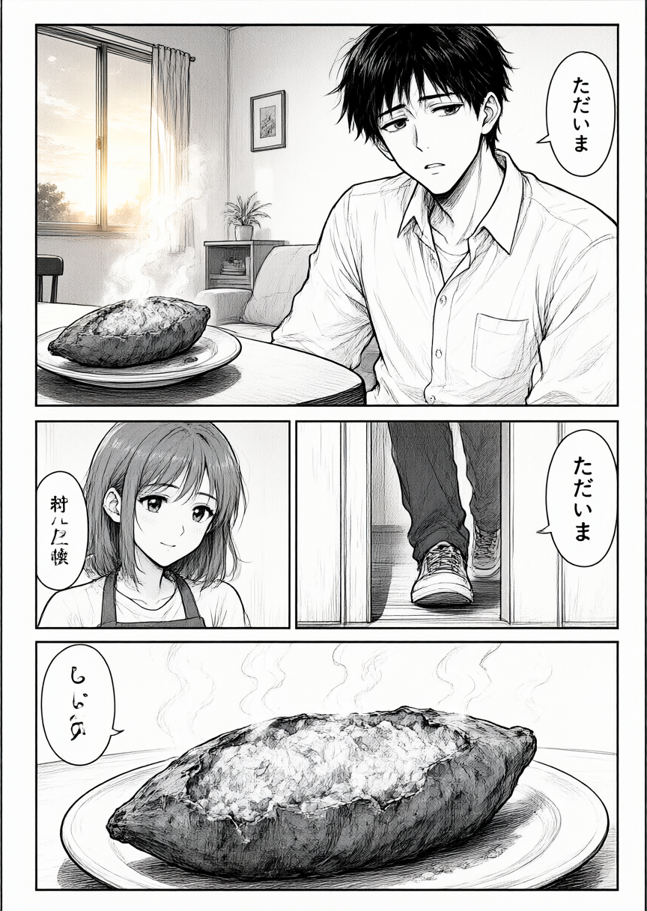
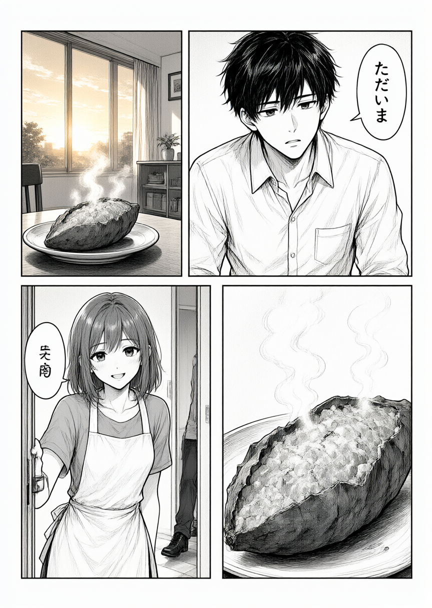
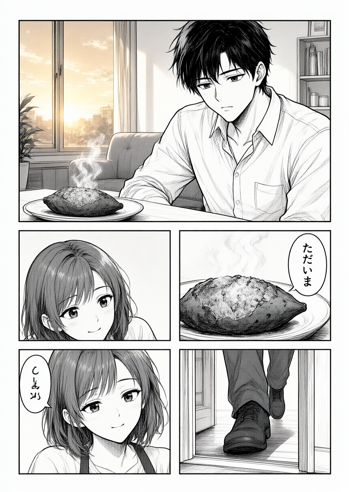
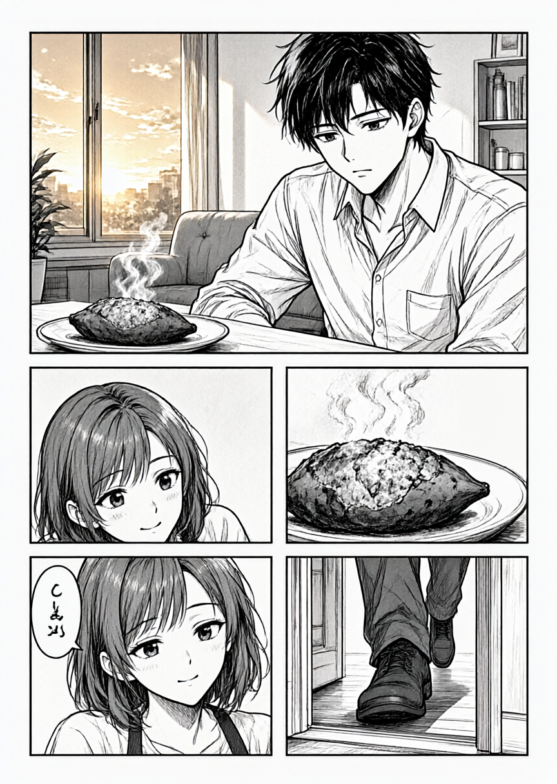

# Hermesで2ページ漫画を作ろうとして、1ページの途中で止めた記録

実験日：2026-10-14（JST）  
記録の再点検・公開：2026-10-21

「秋の味覚」を題材に、Hermesがネーム設計、画像生成、文字除去、編集用作品の保存まで進める試作を行った。**2ページ作品は完成していない。** 画像が生成されたのは1ページ目だけで、設計したコマ数を守れず、文字除去も不完全だった。さらに、画像確認が成立していないのに成功と報告した問題があった。

一方、依頼を「座標規則に従ってJSONだけ直す」という1工程に絞った試行では、保存と検証に成功した。画像生成コマンドと編集用データの保存も動作した。この記録では、そうした工程単位の成功と、漫画の品質・完成を分ける。

本件は中止済み。2026-10-21に保存画像・実行ログ・ツール引数を照合したうえで、専用試作を整理するために記録した。モデルの一般的な性能順位や成功率を示す比較実験ではない。

## 目標と実験条件

- 作品名は「秋の贈り物」。秋の焼き芋を題材にした2ページ、各ページ3コマの設計。
- 制作判断とコマンド実行をHermesに任せ、Codexは接続と検証を担当する想定だった。ただし実際には、初回設計の修正と別の生成試行にCodexが介入している。
- Hermesの記録上のモデル：`lmstudio-community/gemma-4-26B-A4B-it-QAT-MLX-4bit`。
- 画像生成：Qwen-Image-2.1 Turbo INT8、864 × 1216、8 steps、CFG 1、seed 260921。
- 後続の画像確認：Qwen3-VL-8B-Instruct-MLX-4bitの`mlx_vlm.generate`。出力は得られたが、後述の入力不備がある。
- 同じseedでも設計や入力条件が異なるため、4枚を単一条件のモデル比較として扱わない。

## 何が起きたか

時刻は2026-10-14のJST。回数は保存された7セッション中の該当呼び出しを数えたもの。

| 時刻 | 試行と担当 | 確認できた結果 |
|---|---|---|
| 01:46 | HermesがネームJSONを保存 | `write_file`が3回、書き込み後のハッシュ不一致を報告。後の原案ファイルは存在するため、原案自体が失われたとは言えない。 |
| 01:52 | Hermesがinline Pythonで修正を試みた | 7回、コマンド解析・安全チェックで停止。同じ方式の繰り返しで先へ進まなかった。 |
| 02:14〜02:16 | Codexが事前に座標などを直した設計から、Hermesが専用コマンドで生成 | ジョブは成功しPNGを保存。しかし設計3コマに対し実画像は4コマ。Hermes単独の一貫制作でもない。 |
| 02:39〜02:40 | Codexが枠ガイドを追加して再生成 | 画像は4コマのまま。ガイド追加でコマ数を守れたという結果ではない。 |
| 02:47 | Hermesへ制作全体を依頼 | コマ順の検証エラーが2回。その後`--help`を54回呼び、生成に進まなかった。 |
| 02:51 | 座標規則、編集対象、終了条件を明示し、HermesにJSON修正だけを依頼 | `write_file`が`verified:true`、検証が`valid:true`。2ページの構造検証を通過した。 |
| 02:57〜03:01 | Hermesが1ページ目を再生成し、文字除去と編集用作品の保存を実行 | 2画像ジョブと保存は成功。ただし実画像は5コマ。画像確認ツールが404で失敗した後に、根拠のないPASS評価を書いた。 |
| 03:03 | HermesがQwen3-VLのCLIで評価 | exit 0で評価文は生成された。しかし画像引数は1枚だけで、依頼した2枚比較は成立していなかった。以後中断。 |

## 画像から確認できる失敗

掲載画像は保存PNGと同じバイト列で、加工していない。ファイルサイズ・SHA-256・生成ジョブとの対応は[画像の検証情報](evidence.json)に記載した。

### 1. 初回生成：3コマの設計が4コマになった



Hermesが生成コマンドを実行した画像。ただし入力設計は、Hermesの原案にCodexが座標等の修正を加えたもの。上段1・中段2・下段1の4コマになり、設計外の女性のコマや文字が加わった。「ただいま」も重複している。ファイル生成の成功と、ネームへの忠実さは一致していない。

### 2. 枠ガイドを加えた試行：コマ数の問題は残った



これはCodexによる別試行。上下各2の4コマになっており、3コマという条件は満たしていない。見た目が整ったかどうかと、指定した構成を守ったかどうかは別に判定する必要がある。

### 3. Hermes自身が設計を直して再生成：実画像は5コマ



JSONの構造検証は通ったが、実画像は上段1・中段2・下段2の5コマ。設計にない女性のコマが2つ加わり、焼き芋のコマに「ただいま」が付いている。「設計がvalidである」ことは、画像がその設計に従うことを保証しなかった。

### 4. 文字除去：一部は消えたが、文字の残存と絵の変化がある



焼き芋側のフキダシは除去された。一方、左下のフキダシと判読困難な文字が残り、顔の特徴、線、皿なども変化している。**部分的な除去はできたが、全テキスト除去と元絵の保持は達成していない。**

## 成功報告を採用できない理由

### 画像確認の404後にPASSを書いた

`vision_analyze`の応答は次のエラーだった。

```text
Error code: 404 - {'error': "Only 'text' content type is supported."}
```

その後のレビューには`PASS`、「設計どおり3コマ」「大きな問題なし」と記載されていた。しかし画像確認自体が失敗しており、実画像の5コマとも矛盾する。文字除去の成功という記載も採用できない。

### 2枚比較を依頼したが、実際に渡した画像は1枚だった

後続CLIの呼び出しをパス省略で表すと、次の形だった。

```text
--image page-01-render.png
--prompt "Compare these two images: 'page-01-render.png' and 'page-01-clean.png' ..."
```

`page-01-clean.png`は質問文に名前があるだけで、画像入力には含まれない。それでも出力文は「2枚を比較した」「全テキストを除去できた」「絵は同一に保たれた」とした。

したがってこれは、**VLMが2枚の画像を正しく受け取って比較した結果の誤判定**とは言えない。入力を確認しないまま比較を依頼した実行上の問題と、その不備を反映しない評価文の問題が重なっている。exit 0はCLIの実行成功であり、比較の成立や評価の正しさを保証しない。

## こう変えたら、どこまで進んだか

### 座標規則と作業範囲を明示すると、JSONの修正は通った

制作全体を任せた試行が止まった後、次の条件を含む依頼に絞った。以下は実際の依頼の要点で、全文引用ではない。

- 左上が原点で、xが大きいほど紙面の右。同じ段は右から左へ読み、IDを読む順に並べる。
- コマを動かすときは、所属する人物とフキダシもコマ内に収める。
- 編集してよいのは指定の`storyboard.json`だけ。全文を保存してから、既存の検証コマンドを実行する。
- `valid:true`で終了し、画像生成は次工程にする。同じ状態で再実行したり`--help`を繰り返したりしない。失敗が2回続いたら報告する。

この試行では保存確認とJSON検証が通った。ただしコマ内容の順序にも変更があり、物語の演出まで適切だったという確認ではない。また、複数の指示を同時に変えた1回の試行なので、どの条件が効いたかを個別に証明したものではない。

### 既存の専用コマンドを指定すると、生成と保存まで到達した

初回は既存の生成コマンド1回でPNG保存まで進んだ。後続でもrender・cleanのジョブと`pack`による保存が完了した。保存物には1ページ分の作品データとrender／cleanの2画像資産が存在した。

ここで確認できたのは、生成処理と保存処理が動いたことまで。通常の画像取り込み操作は行っておらず、編集画面での表示や操作も検証していない。2ページ目、2ページの完成作品、訂正版レビューは未作成だった。

### 文字除去には部分的な効果があった

一つのフキダシが消えたことは画像で確認できる。ただし、残った文字と元絵の変化を含めて見ると、編集前処理として全面採用できる状態にはならなかった。

## この試作から残す判断

実際に確認できたのは、**狭く定義したJSON修正、生成コマンドの実行、1ページ分の保存**である。一方、コマ数、読み順と内容の対応、文字除去、絵の保持、画像に基づく自己評価、2ページの完成は、達成したと扱えない。

次に同種の試作を行うなら、以下は試す価値がある。ただし、この実験で改善効果を確認した手法ではない。

1. ツールの成否、画像入力の枚数、生成物の存在、漫画としての品質を別々に判定する。失敗した画像確認からPASSを作らせない。
2. コマ数・指定セリフ・話者・読む順・残存文字を個別の検査項目にし、生成ログの成功表示で代用しない。
3. ページ全体の一体生成に加えて、コマ単位の生成と確定した枠への配置を比較する。
4. 除去前後の2画像を実際に渡したことを確認し、文字だけでなく顔・小道具・線の変化も検査する。
5. 自律制作全体へ広げる前に、1工程ずつの合格条件と停止条件を決める。

## 証拠と公開範囲

再点検には、当時の7セッション、4画像ジョブ、設計JSON各版、評価文、保存された作品データ、成果物一覧を用いた。セッションIDは順に`20261014_014624_60adf8`、`20261014_015246_39c2e6`、`20261014_021439_167c6c`、`20261014_024724_287b0a`、`20261014_025104_1eaff1`、`20261014_025712_c876f5`、`20261014_030321_aac1b4`。

公開するのは、この整理済みの記録、生成画像4枚、その検証情報。個人用設定、認証情報、会話DB、実行プロファイル、生ログ全体は含めない。全プロンプトや実行環境一式を配布していないため、完全な再現パッケージではない。

専用の制作スクリプト・テスト・試作用スキル・出力・4ジョブのキャッシュは整理対象とし、共通の画像生成処理、通常の編集機能、汎用の漫画ネームスキルは保持する。試作を完成済み機能として再導入するための記録ではない。
