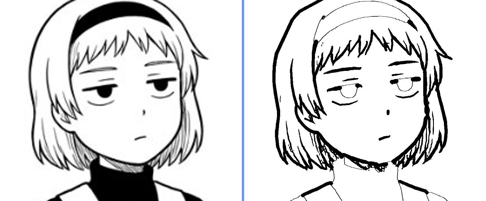
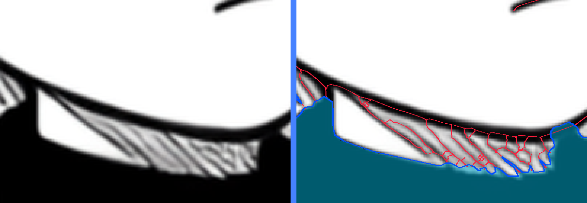
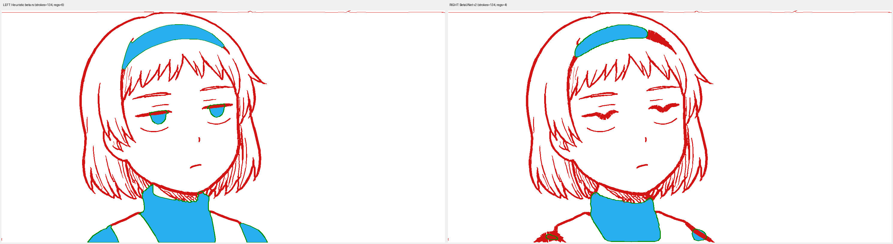
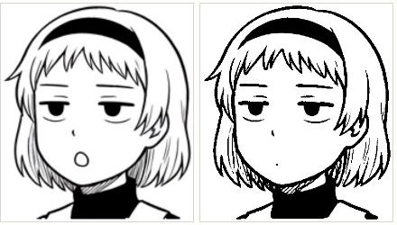

# 漫画線画のベクター変換パイプライン開発と失敗の記録

実験・開発期間：2026-11-26〜27（JST）

[Nyamuru（ニャムル）](https://github.com/yukincom/nyamuru-image-hub)のペイントエディタ向けに、ラスターのモノクロ漫画線画を「編集可能な可変太さベクター線画（3次ベジェ／CSPネイティブスプライン互換）＋分離済み黒ベタ塗り」へ変換するパイプラインを開発した記録である。

本記録では、最終採用構成だけでなく、**初期段階の破綻、ハッチングへのベタ侵食、自作 `.clip` 原稿83ページで学習した U-Net モデルの不採用判断、丸い口が1ドットに消えた閉ループの不具合**までを、開発途中の検証画像（著者自作キャラクター「小雪」）とともに残している。

> **掲載画像について**  
> 本記事の方針として、**安定化後の完成例やUIスクリーンショットは掲載せず**、切り分け・修正に直結した失敗時の画像4点のみを掲載している。いずれも著者自身のキャラクター描画である。

---

## 目標と採用した構成

低解像度（例：横370px程度）の生成・下書きラスター画像から、CLIP STUDIO PAINT 上でそのまま筆圧風の線幅とベクター操作感を維持して加筆修正できるデータを作ることを目標とした。最終的に Nyamuru の「ベクター変換」機能として採用した構成は次のとおり。

- **前処理（超解像）**：[`2x_IllustrationJaNai_V3denoise_SPAN_S_30k_fp16`](https://github.com/the-database/MangaJaNai/releases/tag/3.0.0)（ONNX・832 KB、`npm run setup:vision` で SHA-256 二重検証付き自動取得）
  - ダイアログのリアルタイムプレビューは常に「高速（2x）」で即時返し、「高品質（4x）」選択時は「適用」押下時のみ 4x 本変換を行う設計にした（小さいプレビュー枠では 2x と 4x の差が見えにくく、プレビュー待ち時間だけが増えるため）。
- **ベクター化コア（Rust）**：[`line-trace-strokes`](https://github.com/nekomimianko/line-trace-strokes)
  - ぼけ幅自動推定付きのヒステリシス細線リッジ抽出、2D EDT による中心線・可変半径抽出、Taubin スムージング＋直線スナップ＋Schneider 最小二乗3次ベジェフィット。
  - **交差点AIモデル `JunctionPairNet`**：合成交差点データで学習した軽量 MLP（検証 F1 `0.4129 → 0.9638`、浅いX字通過再現率 `29.6% → 92.6%`、T字誤結合 `35 → 2`）の重みを Rust バイナリへ直接埋め込み。外部モデルファイル不要で動作する。
  - **ベタ分離とベクター枠**：線幅中央値 `r_med` に応じた適応的 EDT コア検出＋局所インク密度ガード＋円形モルフォロジーオープニングによりベタ領域を分離し、内側へ後退させたベタマスクの閉輪郭（`fill_contour`）とラスター `ベタ塗り` レイヤーを非破壊フォルダーへ出力する。

---

## 試行の経緯と不採用になった案

| 時期 | 試みた手法 | 結果と採用判断 |
|---|---|---|
| 初期（v5前後） | 基本 EDT 骨格抽出＋素朴なベタ検出・先細り外挿 | カチューシャや瞳のベタが大きく抜け、毛先のヒゲや上まぶたの途切れが発生。改善ベースとして改良を継続 |
| 中期（ベタ境界調整） | 原輪郭からの法線インセット＋線分クリッピング（`clip_contours_by_lines`）／大きめの死端吸収 | ピンホール状の極小閉ループ多発と、首元ハッチングの根元までベタが侵食する現象を確認。いずれも**不採用・撤去** |
| 中期（AIモデル化試行） | 自作 `.clip` 原稿83ページから学習した3クラス U-Net（`BetaUNet v1/v2`）で `beta.rs` を置換 | 検証セット IoU は高い（`Beta IoU 0.9401`）ものの、実画 E2E で瞳・カチューシャ先端など小ベタが抜け落ち、**本番不採用（ロールバック）** |
| 仕上げ前 | 閉ループの3次ベジェ化（既存実装） | 角点0個の滑らかな閉じた丸（口など）が1ドットに消えるバグを発見。4象限分割フィットへ修正して**採用** |
| 最終UI整理 | 多項目パラメータ（長辺サイズ・方式名・元画像並列比較・統計表示） | 実運用に合わせて4項目（処理モード・しきい値・間引き許容・交点処理）＋変更後のみプレビューへ整理して**採用** |

---

## 画像で確認できる主な失敗と原因

### 1. 初期段階：ベタ領域の抜け・毛先の荒れ・上まぶたの途切れ

左が入力、右が初期パイプライン（v5時点）の出力である。

- **カチューシャ・左右の瞳の黒ベタが線扱いになって中抜け**し、白い輪郭線だけが残っている。
- **首元の斜線ハッチングと顎境界**が粒状のノイズ・ぎこちない折れ線になり、毛先や上まぶたにも途切れがある。
- この結果から、(1) 2D EDT の膨張条件を平均線幅 `r_med` に連動させること、(2) 上まぶたや顎線などベタと接する輪郭を Hermite 補間で1本に橋渡しすること（`bridge_across_beta_grazes`）、が必要と分かった。

### 2. 首元ハッチングへのベタ侵食と境界のギザつき

首元の赤枠周辺を拡大した検証画像である。

- ハイネックの首元ベタを測地膨張させるとき、細い斜線（ハッチング）との接続部で膨張が止まらず、**ハッチングの根元を食いながら歯型状のベタ境界（青緑）**ができていた。
- また、孤立した短い終端線をベタに吸収する処理の面積上限を大きくしすぎたときも、同じようにハッチングの根元が飲み込まれた。
- 対策として、O(N) 2D累積和（Integral Image）による局所インク密度 `s(x, y)` ガードと、線幅比例の円形モルフォロジーオープニング、`max_dead_tip_area <= 36` への制限を導入し、幾何計算だけで歯型を断ち切れるようにした。

### 3. 自作3クラス U-Net（`BetaUNet v2`）によるベタ分離の失敗と不採用判断

「ルールや閾値を手作業で増やす代わりに、著者自身の `.clip` 原稿から『背景・線画・ベタ』を直接学習する軽量 U-Net を作れば汎用化できるのでは」と考え、読取専用でデータセットを構築しモデルを学習した。

- **学習データ**：著者の `.clip` 原稿から抽出した計83ページ（2026年作品20ページ＋2016〜2022年アーカイブ63ページ）、512×512 タイル **学習 2,310枚 / 検証 238枚**（完全ページ単位ホールドアウト）。
- **モデル**：Depthwise-Separable U-Net + Dilated Bottleneck（`BetaUNet base=32`、**806,947パラメータ**、ONNX **3.09 MB** / opset 17）。
- **学習環境・結果**：Google Colab NVIDIA L4 GPU で60エポック学習。検証セット最良スコア（Ep 50）は **`fg_mIoU = 0.9191`**（背景 IoU `0.9984`、線画 IoU `0.8980`、ベタ IoU `0.9401`）、CPU 推論速度も `561×622` で約100msと軽快だった。

しかし、実際の Nyamuru パイプライン（`ai4x` で `1480×776` へ拡大後のベクター抽出）へ差し替えて E2E 比較したところ、**明確な品質後退**が起きた。

右図（`BetaUNet v2` 直入れ）では、左図（`beta.rs` ヒューリスティック）が6領域（`59,380 px`）を綺麗に分離できているのに対し、**4領域（`41,713 px`）に減り、左右の瞳・カチューシャ右先端・両肩角のベタが抜け落ちて赤い太線ゴミ化**している。原因は次の3点と分析した。

1. **教師データの「ベタ定義」を忠実に覚えすぎた**：600dpi の1レイヤー描線から自動ラベルを作る際、「300dpi で直径 25px 以上をベタ、外周 2.5px は線画」というルールで正解マスクを切ったため、モデルが小ベタを「線画」と判定し、かつベタの外周に線画のフチを残す癖がついた。
2. **ピクセル絶対スケールへの依存**：小コマ入力（`370×194` 等）では瞳の直径が数px〜十数px程度しかない。毎回その画像の線幅中央値 `r_med` で閾値を伸縮する `beta.rs` に対し、固定受容野の畳み込みネットワークは小コマの小ベタを取りこぼした。
3. **責務の丸投げ**：`BetaUNet v2` 自体は「密集した草むらや黒背景と髪を見分ける文脈判断」では優れていたにもかかわらず、小ベタの精密境界や閉輪郭抽出まで単体で置き換えてしまった。

実機画面でも品質後退を確認したため、本番コードから `BetaUNet v2` を即時ロールバックし、学習済み重みのみ実験アーカイブとして保管する判断とした。

### 4. 角点0個の閉ループ（丸い口）が1ドットに消失した不具合

終盤になって、「驚き顔などの丸い口（`o`）だけが跡形もなく消え、小さな1点になる」不具合が見つかった。

- **原因**：`line-trace-strokes` の 3次ベジェ当てはめ（`bezier.rs`）は、まず多角形から角点（`corner`）を検出し、角点と角点の間ごとに `is_straight_span`（直線判定）と `fit_cubic_recursive` を回す構造だった。
- しかし、`o` のように**角点が1つも検出されない滑らかな閉ループ**では、「始点 `0` から1周回って終点 `n-1`（＝始点と同一座標）まで」の **1区間だけ** が切り出され、始点〜終点の弦長 `chord` が `0.0 px` になる。
- 当時の `is_straight_span` が `chord < 1e-4` だけで即 `true` を返していたため、**直径数十pxある円ループ全体が「長さゼロの点」と誤判定され、制御点1個だけのゴミストロークに潰れていた**。
- **修正**：(1) `is_straight_span` で `chord < 1e-4` のときは全中間点が許容誤差 `max_err` 以内である場合のみ直線とみなすよう修正し、(2) 角点0個の閉ループは自動で4象限（`0, n/4, n/2, 3n/4, n`）に分割して C1 連続接線で3次ベジェを当てはめるよう変更した結果、半径 8〜28px の円が安定して4〜5ノードの閉ループ楕円として復元されるようになった。

---

## 今回の検証から得られた知見

1. **「検証セットのピクセル IoU が高い」ことと「下流のベクター品質が良い」ことは一致しない**  
   `BetaUNet v2` は教師データ上の Val IoU 0.9191・ベタ IoU 0.9401 を達成したが、小ベタの1〜2px欠損が後段のスケルトン化と組み合わさると「途切れた太線ゴミ」に増幅された。ピクセル単位指標ではなく E2E のベクター出力で比較したことで誤採用を防げた。
2. **スケール不変な幾何量（線幅 `r_med` 基準の EDT）と学習モデルの住み分け**  
   「その絵のペン線に対して何倍太いか」「局所密度が高いか」といった幾何的正規化が効く局所分離は、`r_med` ベースの幾何アルゴリズムの方が極小コマから大判まで安定する。
3. **極端な境界ケース（角点0の閉ループ・弦長ゼロ）は実絵の表現で顕在化する**  
   通常の線や四角形では問題にならない `chord = 0` の単一区間が、漫画で頻出する「丸い口」「ボタン」「丸フキダシ」でそのまま消失バグになった。単体テストに閉円ループ回帰を追加した。

---

## 関連リポジトリ・出典

- 本体統合・UI・自動セットアップ（`setup:vision`）：[yukincom/nyamuru-image-hub](https://github.com/yukincom/nyamuru-image-hub)
- Rust 線画トレース・ベタ分離・3次ベジェ変換エンジン：[nekomimianko/line-trace-strokes](https://github.com/nekomimianko/line-trace-strokes)
- 超解像前処理モデル出典（IllustrationJaNai V3denoise SPAN_S）：[the-database/MangaJaNai Releases 3.0.0](https://github.com/the-database/MangaJaNai/releases/tag/3.0.0)
